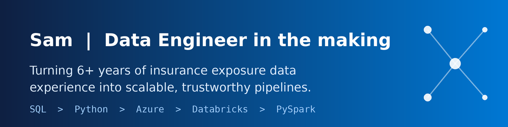
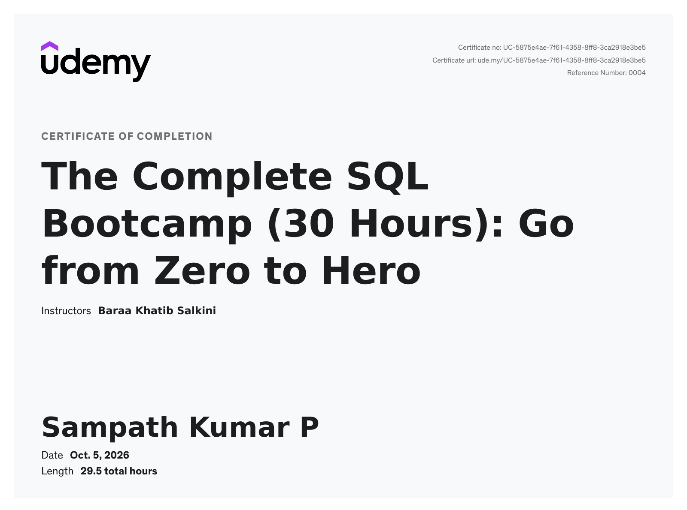

  

### Hello, I am Sampath 👋
### Thanks for stopping by. Here's a bit about myself...

- 🧑‍💻 I'm currently transitioning into **data engineering**. That means...
  - 📚 I study and practice every day, and I build in public
  - 🤝 I'm open to conversations, collaborations and data engineering opportunities
  - 🛠️ You can find my practice projects in my pinned repositories

- 🧱 My background:
  - 🏢 6+ years in catastrophe-model **exposure data handling** (Verisk, 2019 to 2025)
  - 📊 Standardizing, validating and geocoding very large property datasets (TIV, reinsurance layering)
  - 🔍 Strong instincts for data quality, because I know where bad data hides

- 👨‍🎓 I am currently learning:
  - 🗄️ SQL (window functions, recursive CTEs, query logic)
  - 🐍 Python and Pandas, picked up through projects
  - ☁️ Azure, Databricks / PySpark and Data Factory (on the roadmap)
  - ☁️ AWS, S3, Athena, Glue basics, Airflow (on the roadmap)

          

- 💬 Here's how you can reach me: [LinkedIn](https://www.linkedin.com/in/sampath-kumar-p-01904216b) | [Email](mailto:sampathbunty6@gmail.com)

- 🔖 Here are my projects so far:
  - [SQL-zero-to-hero](https://github.com/Sampathkumar6/SQL-zero-to-hero): my SQL learning journey, from SELECT to window functions and recursive CTEs
  - [sql_data_warehouse_project](https://github.com/Sampathkumar6/sql_data_warehouse_project): Building data warehouse from scratch using medallion (Bronze, Silver, Gold) architecture
  - [databricks_Lakehouse_pipeline](https://github.com/Sampathkumar6/databricks_bootcamp): Building an end-to-end Lakehouse pipeline,a mini hands-on project with Databricks 

- 🎓 My certifications and courses:
  - [SQL Zero to Hero, Udemy (completion certificate)]

<table>
  <tr>
    <th align="center">Certificate</th>
  </tr>
  <tr>
    <td align="center"></td>
  </tr>
</table>
  
 
If you want to talk to me or discuss something, feel free to ping me on LinkedIn.
